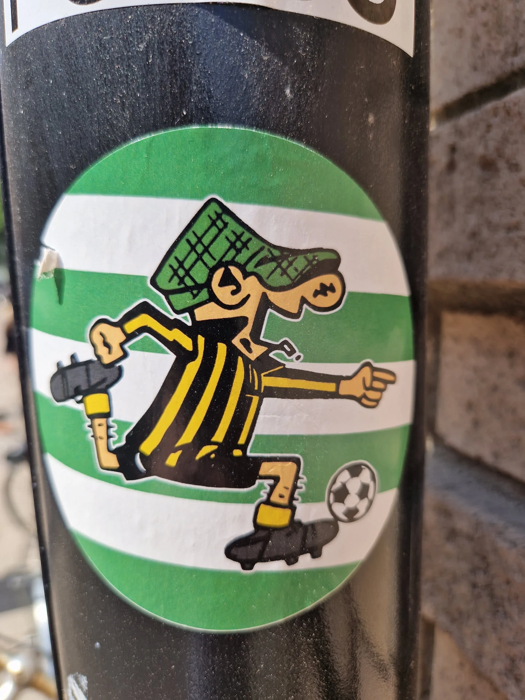
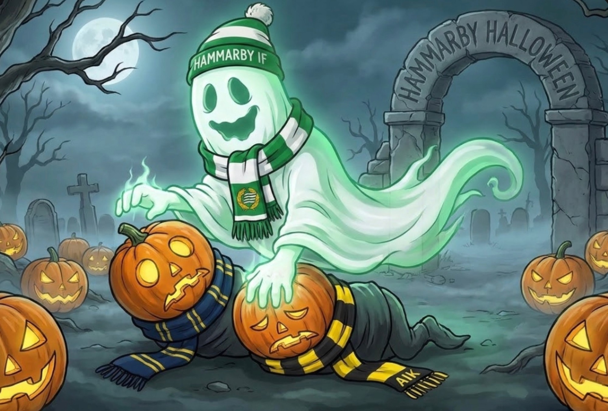
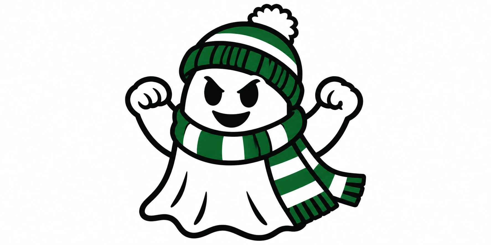
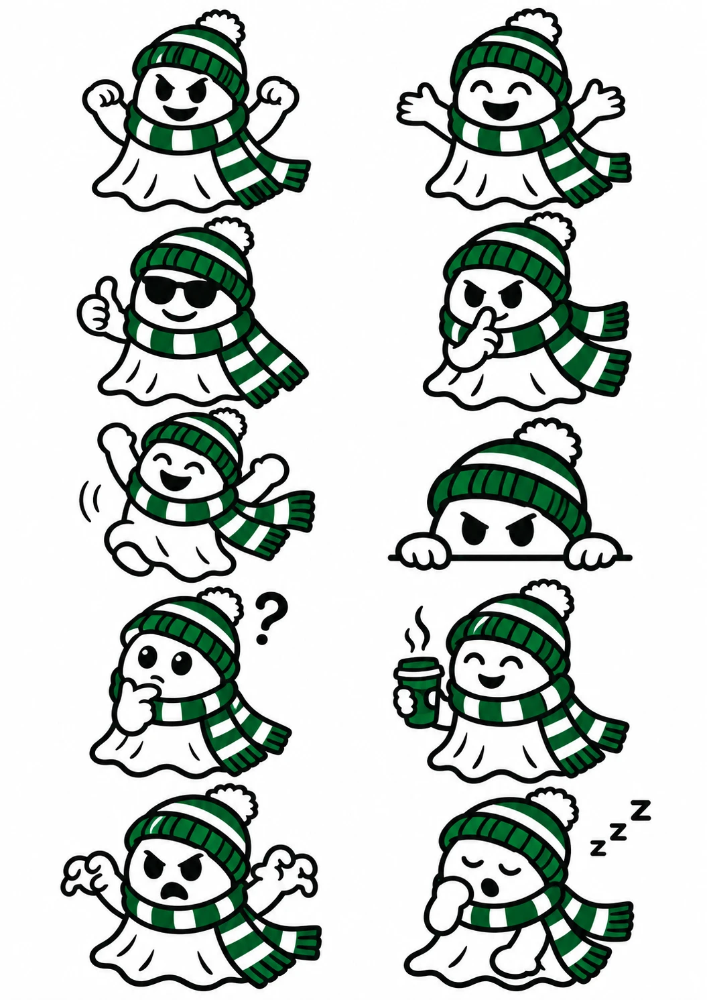
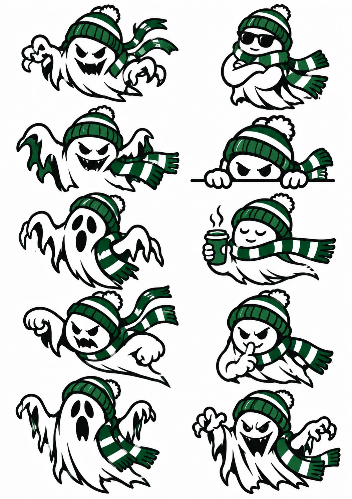
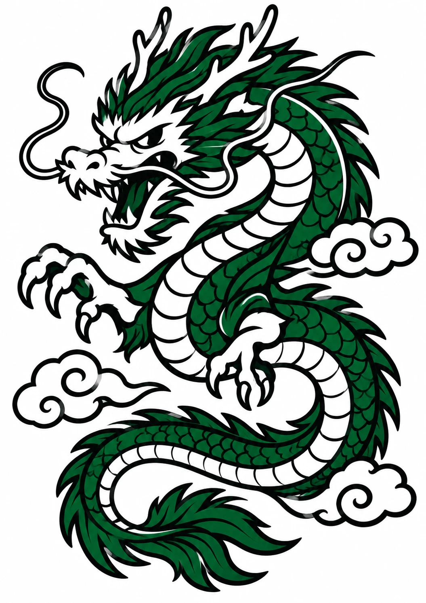
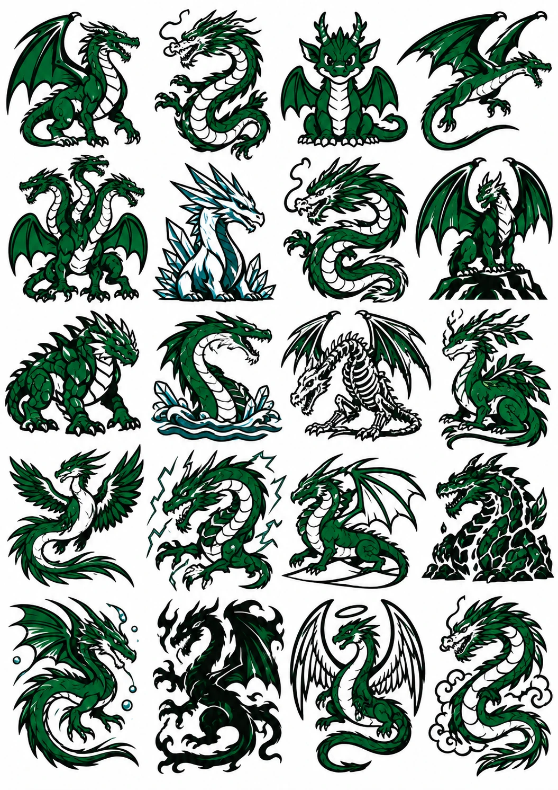
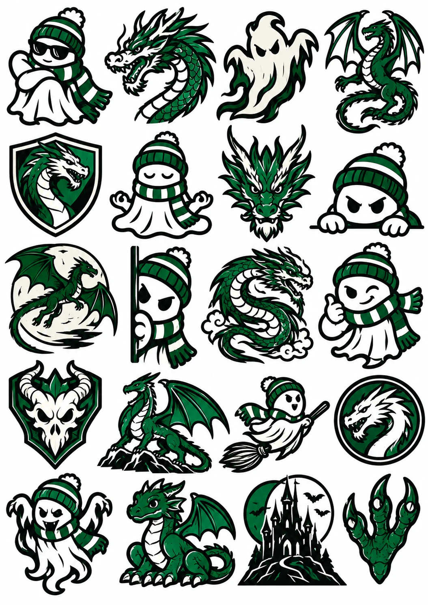
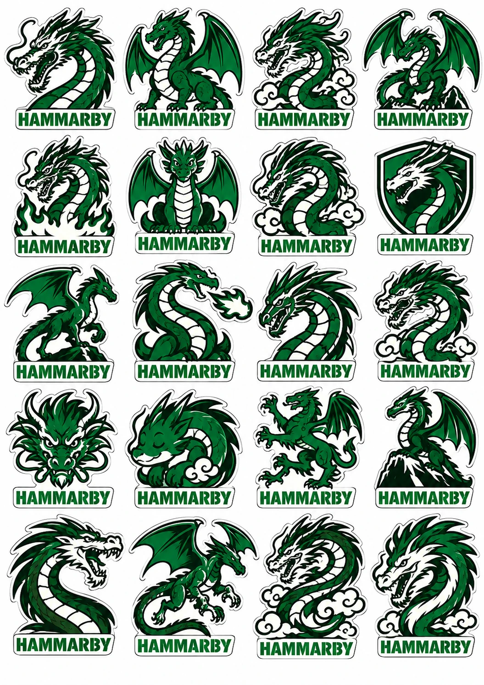

# Logobaren.se – Eget varumärke och figur

**Datum:** 31 oktober 2026  
**Status:** Idéarbete. Inget är testat på kunder eller juridiskt granskat.

---

## 1. Sammanfattning

- **Rekommendation:** fortsätt med en egen spökfigur som huvudspår. Använd draken som jämförelse i testet.
- **Struktur:** Logobaren är bolaget och butiken. Varje klubb får en egen version av figuren, men börja bara med Södermalm/Hammarby-kretsen.
- **Juridik:** sälj inget med klubbnamn, klubbmärke eller en figur som någon annan kan äga, innan rättigheterna är utredda.
- **Nästa steg:** sluta generera varianter och testa fyra motiv med riktiga förbeställningar.

---

## 2. Så växte idén fram

1. **Ölgubben:** första idén var en tecknad figur med stor mage och öl, i grön-vita kläder. Den ger humor, men krockar med målgruppen som vill ha subtil tillhörighet och kan begränsa annonsering och presentköp.
2. **Dekalen:** en figur som syns runt Hammarby visade vilken känsla som fungerar, men kan ha en upphovsperson.
3. **Spöket:** en Halloween-bild gav idén till ett spöke med mössa och halsduk.
4. **Prototyper:** AI-genererade spöken och drakar togs fram för att få igång tankarna.

---

## 3. Referensbilder – får inte användas i produkter

### Dekalen

- Figuren har rutig grön keps, stor näsa och svartgul randig tröja på grön-vit botten.
- Svartgult är en insiderkod. Hammarby spelade i svartgult från 1918 till runt 1978–1980, men utomstående kan förväxla färgerna med AIK.
- Stilen påminner om Andy Capp. Det är bara ett intryck och ingen koppling är bekräftad.
- Vem som ritat figuren och vem som äger rättigheterna är okänt.

**Slutsats:** kopiera den inte. Försök hitta upphovspersonen, eftersom ett samarbete kan ge både rättigheter och trovärdighet.

### Halloween-bilden

- Idén om ett spöke med halsduk är fri att använda.
- Den här bilden innehåller klubbnamn och klubbmärke, och en AIK-halsduk. Ursprunget är dessutom okänt.

**Slutsats:** använd bara idén, inte bilden.

---

## 4. Prototyper

### Kaxigt spöke – huvudfigur

Arg blick men glatt leende ger läktarkänsla utan att bli elakt. Det här är kandidaten till huvudfigur.

### Spöken, ark 1

Hysch-spöket (rad 2, höger) har en färdig poäng: "Psst, vilken jobblogga?" Kaffe och zzz passar bättre som klistermärken och i sociala medier.

### Spöken, ark 2

Välj bort skräckspökena. Trasiga kanter och tänder är svåra att brodera, och figuren tappar charmen. Solglasögon med korslagda armar är en bra reserv.

### Enskild drake

Snygg, men fjäll, klor och moln kräver stor yta. Passar i så fall som ryggpatch.

### Drakar, ark

Varierat, men många liknar vanliga fantasydrakar. Ett par motiv har också blå detaljer utanför färgskalan.

### Blandat ark

| Motiv | Plats | Bedömning |
|---|---|---|
| Tittut över kanten | Rad 2, längst till höger | Förstaval för att täcka loggor |
| Tittut från sidan | Rad 3, andra från vänster | Kan kika fram längs dragkedja eller knappslå |
| Blink och tumme upp | Rad 3, längst till höger | Lätt att gilla, bra som present |
| Mediterande spöke | Rad 2, andra från vänster | Rolig sidolinje |
| Tjock liten drake | Rad 5, andra från vänster | Bästa draken för broderi |

Välj bort spöket utan mössa, dödskallen, slottet och klon. Kvasten fungerar bara som ett Halloween-drop.

### Drakar med "HAMMARBY"

**Kan inte säljas utan licens eller juridiskt klartecken.** Namnet ihop med grön-vitt och supporterkänsla pekar tydligt på klubben, även om Hammarby också är ett områdesnamn. Sköldarna liknar dessutom klubbmärken.

Arket visar ändå att ett ord gör stor skillnad. Testa formatet med tillåten text, till exempel "SÖDER" eller ett eget figurnamn, efter juridisk bedömning.

---

## 5. Spöke eller drake

| | Spöke | Drake |
|---|---|---|
| **Känsla** | Humor och charm | Kaxighet och läktarkänsla |
| **Målgrupp** | Kretsen runt supportrarna, presenter | Kärnsupportrar |
| **Koppling till affärsidén** | Ett lakan täcker något, som patchen täcker loggan | Ingen koppling till återbruk |
| **Broderi** | Enkelt efter förenkling | Svårare, utom den tjocka draken |
| **Nya klubbar** | Samma figur, nya färger och detaljer | Mer generisk |

En risk med spöket är att spöken är vanliga. Skyddet ligger i den specifika teckningen och namnet, inte i idén.

---

## 6. Produktionskrav

- **Förenkla:** färre och grövre linjer i mössa, halsdukstofsar och veck, särskilt under 8 cm.
- **Färger:** cirka 4–6 enfärgade ytor, utan glöd och toningar.
- **Ljusa plagg:** ett vitt spöke behöver en tydlig kant.
- **Form:** börja med en patch utskuren längs figuren, men kontrollera att loggan verkligen täcks.
- **Prov:** be om digitalt korrektur och broderade prover i 8 cm och 12x6 cm.
- **Fäste:** testa på riktiga västar och skaljackor, inklusive tvätt och ovanpå tryck eller brodyr. Strykning kan fungera dåligt på just dessa material.

### Verktyg

| Steg | Verktyg |
|---|---|
| Idéskisser | ChatGPT, Midjourney eller Runway |
| Vektorfil | Recraft, Illustrator eller Vectorizer.ai |
| Bilder på plagg | ChatGPT eller Photoshop |
| Broderifil | Leverantören eller Ink/Stitch |

---

## 7. Rättigheter att reda ut

- [ ] Sök "Bajen", "Hammarby" och det egna figurnamnet i PRV:s varumärkesregister.
- [ ] Sök "Logobaren" som varumärke, inte bara som domän.
- [ ] Ta reda på vem som ritade dekalfiguren.
- [ ] Låt en tecknare rita den slutliga figuren från grunden, med skriftligt avtal om att rättigheterna går över.
- [ ] Låt en jurist bedöma färdig design, inklusive kombinationen av färger, "SÖDER" och 1897.
- [ ] Kontrollera att AI-verktygens villkor tillåter kommersiell användning.
- [ ] Vänd dig till klubben om licens när det finns försäljning att visa upp.

Rena AI-bilder kan ha svagt skydd, så se dem som skisser. Punkterna ovan är arbetsanteckningar och inte juridisk rådgivning.

---

## 8. Test och nästa steg

Testa de här fyra motiven:

1. Kaxigt spöke
2. Tittut över kanten
3. Blink och tumme upp
4. Tjock liten drake

Så går testet till:

1. Gör rena vektorversioner och lägg in dem på samma mörka väst, med en företagslogga synlig före och täckt efter.
2. Visa bilderna för 20–30 personer, både från klacken och kretsen runt omkring.
3. Be dem förbeställa sin favorit med Swish för företag. Säg tydligt att det är en prototyp och när leverans kan ske.
4. Beställ prover av vinnaren och testa på riktiga plagg.
5. Låt några supportrar se figuren tidigt, eftersom ett dåligt mottagande där kan stoppa Fas 1.

**Bestäm i förväg:** hur många förbeställningar som krävs, på hur lång tid och vad som gör att du byter spår eller lägger ner.

---

## 9. Från genomgången av affärsplanen

### Kalkylen behöver räknas om

| | Enligt prognosen | Omräknat |
|---|---|---|
| Omsättning år 1 | 396 750 kr | 317 400 kr (exkl. moms) |
| Marginal per enhet | ~78 % | ~53 % (efter porto) |
| Resultat år 1 | +189 465 kr | ~+48 000 kr |

Omräkningen antar att priserna är inklusive moms, att varje order är en enhet och att Logobaren betalar portot på 18 kr. Ingen lön är inräknad.

### Motsägelser i dokumenten

- Omsättningsmålet är 480 000 kr på 3 200 enheter, men prognosen visar 396 750 kr på 3 450.
- Priset är 149–299 kr i analysen, men 69–179 kr i underlaget.
- Enskild firma i analysen krockar med 10 % ägarandel och nyemission i underlaget. Det senare kräver aktiebolag.
- 3-klicksköp med automatisk adress krockar med MVP:n med manuell Swish. BankID ger såvitt känt inte adress.
- Privat Swish i analysen bör bytas mot Swish för företag.
- "Validerat marknadsbehov" stämmer inte, eftersom inget är validerat ännu.
- "Ingen sömnad krävs" krockar med sy-kit och kardborre.
- "Miljödriven" krockar med flygfrakt och kräver underlag.

### Det som saknas

- Riktiga kundsamtal och förbeställningar
- Stoppkriterier
- Din tid, roll och lönebehov
- Villkor för skadade plagg och vad "täckningsgaranti" innebär
- Mätdata på loggstorlekar till täckningsverktyget
- Leverantörsofferter inklusive tull och importmoms
- Plan för osålt lager när nästa lag tar över
- Trafikplan, konkurrentanalys och plan för supportrarnas reaktion

### Timing

Allsvenskan är i stort sett slut för säsongen. Julklappar kan bli ett första test om prover och leverans hinns med, annars passar en lansering inför seriestarten i vår bättre.

---

## Källor

- [Hammarby Fotboll – Wikipedia](https://en.wikipedia.org/wiki/Hammarby_Fotboll)
- [Hammarby IF – Wikipedia](https://en.wikipedia.org/wiki/Hammarby_IF)
- [Andy Capp – Wikipedia](https://en.wikipedia.org/wiki/Andy_Capp)
